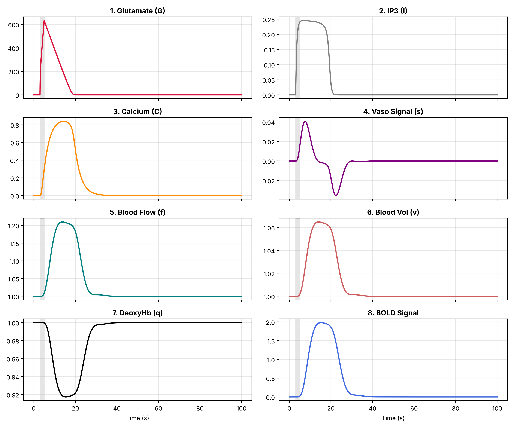

# Tripartite-Engine

[](https://github.com/BrometryDash/Tripartite-Engine/actions/workflows/ci.yml)


A small ODE model of neurovascular coupling in which the link between synaptic activity and the BOLD signal
goes through an astrocyte. A presynaptic firing rate depletes vesicles, the released glutamate drives astrocytic
IP3 and Ca2+, and the Ca2+ drives a standard hemodynamic (Balloon) model that gives a BOLD signal. There are
eight state variables and ten short experiments that poke at the model (firing-rate sweep, blocking glutamate
uptake, sensitivity analysis, uncertainty, comparison with the canonical HRF and so on).

This README explains what each experiment shows and, as far as I could, how that compares with measurements
from the literature. The short version is that the model produces a BOLD-like response of reasonable size, but
it is about twice as slow as a real hemodynamic response, the glutamate levels it uses are far too high, and
its main assumption (that astrocytic Ca2+ drives the vessels) is disputed by in-vivo experiments. Details and
numbers are below. The model is not fitted to any data.



## Contents

1. [The model](#1-the-model)
2. [Running the code](#2-running-the-code)
3. [Results, and how they compare with real data](#3-results-and-how-they-compare-with-real-data)
4. [Summary of the comparison](#4-summary-of-the-comparison)
5. [Limitations](#5-limitations)
6. [What I would do next](#6-what-i-would-do-next)
7. [Reproducibility and tests](#7-reproducibility-and-tests)
8. [References](#8-references)

## 1. The model

```
firing rate R(t) -> V vesicles -> G glutamate -> I IP3 -> C Ca2+ -> s -> f flow -> v, q -> BOLD
  (square pulse)     depression     uptake        astrocyte (simple)      Balloon model
```

- **Synapse.** The fraction of releasable vesicles V is depleted by release and recovers with a time constant
  tau_rec. This is the rate-based form of the Tsodyks and Markram (1997) depression model. Released
  glutamate G accumulates in one lumped extracellular pool and is removed by a Michaelis-Menten uptake term
  (transporter affinity from Arriza et al., 1994).
- **Astrocyte.** G drives IP3 production through a saturating term, and IP3 drives Ca2+ release through a
  saturating (Hill-type) term, with first-order decay of both. I wrote this part as a simple phenomenological
  module, it is not copied from a published astrocyte model.
- **Hemodynamics.** Ca2+ drives a vasodilatory signal s, which drives flow f. Volume v and deoxyhemoglobin q
  follow from the Balloon model (Buxton et al., 1998; Friston et al., 2000). The BOLD signal comes from the
  standard BOLD equation (Buxton et al., 2004; Stephan et al., 2007).

The stimulus is a square pulse in firing rate, 20 Hz from t = 3 s to t = 5 s unless I say otherwise. All
times quoted as "time to peak" (TTP) are measured from stimulus onset (t = 3 s).

Everything is one-directional: nothing from the astrocyte or the vessels feeds back to the neuron. So
"tripartite" here only means that the model has a synapse part, an astrocyte part and a vessel part.

The equations, the initial conditions and a table with the source of every parameter value are in
[docs/MODEL.md](docs/MODEL.md). Of the 17 parameters, 8 have a source (or are in the published range) and 9 have
none (rho, V_max, K_G, k_prod, k_deg, J_max, K_I, tau_Ca, epsilon). Two BOLD constants and E_0 also differ from
the usual literature values (see limitation 7).

## 2. Running the code

```bash
git clone https://github.com/BrometryDash/Tripartite-Engine.git
cd Tripartite-Engine
python -m venv venv
source venv/bin/activate          # Windows: venv\Scripts\activate
pip install -r requirements.txt

python run_all.py                 # all experiments, about 50 s, writes into results/
python run_all.py exp_2 exp_7     # only experiments whose file names start with these
python experiments/exp_1_frequency.py   # a single script, works from any folder
```

Using the model directly:

```python
from core.solver import get_baseline_parameters, run_simulation

params = get_baseline_parameters()
t, y, bold, ok = run_simulation(params, stim_freq=20.0, t_span=(0, 40))
print(bold.max())    # about 1.98 (% BOLD)
```

Layout:

```
core/solver.py       the ODEs, the BOLD equation and the simulation function
experiments/         exp_0 ... exp_9 and exp_diagnostic (each writes into results/)
results/             CSV / JSON / PNG output of the last run
tests/               pytest tests
docs/MODEL.md        equations and parameter sources
run_all.py           runs all experiments
```

## 3. Results, and how they compare with real data

Baseline everywhere: 20 Hz pulse, 3 to 5 s, parameters from `get_baseline_parameters()`. Every number below
is produced by the scripts in `experiments/` (a few come from the CSV/JSON files in `results/`).

Two things to keep in mind when reading the comparisons. First, the model is a single lumped "voxel" with an
idealised input, so I can only compare shapes, timescales and orders of magnitude, not exact values. Second,
the BOLD amplitude depends on the constant V0 and on k3, which I set differently from the usual literature
values (limitation 7), so I put less weight on amplitude comparisons than on timing.

### 3.0 Chain of events (diagnostic run)

`experiments/exp_diagnostic.py` runs the baseline and records the peak of every variable.

| Variable | Peak | Time to peak (s after onset) |
|---|---|---|
| Vesicles V (minimum) | 0.135 | 1.98 |
| Glutamate G | 632 uM | 2.00 |
| IP3 I | 0.246 uM | 3.72 |
| Vasodilatory signal s | 0.041 /s | 4.56 |
| Ca2+ C | 0.840 uM | 11.38 |
| Flow f | +21.0 % | 10.76 |
| Volume v | +6.5 % | 11.08 |
| Deoxyhemoglobin q (minimum) | 0.917 | 12.42 |
| BOLD | 1.98 % | 12.22 |

The fast things (vesicles, glutamate, IP3) peak within a few seconds. Then there is a long gap before Ca2+ and
everything downstream peaks at about 11 to 12 s. Flow peaks slightly before Ca2+, which is possible because the
flow feedback term (gamma) starts pulling flow back while Ca2+ is still near its maximum.

*Comparison with real data.* BOLD following flow with a lag of roughly 1 s is what the Balloon model is
supposed to do (Stephan et al., 2007), and the 1.5 s lag here (flow 10.76 s, BOLD 12.22 s) is in that range.
The overall timing is the problem: the whole cascade is slow (see 3.6). Also, the ordering of Ca2+ and flow
is the opposite of what some in-vivo measurements report. Nizar et al. (2013) found that the onset of
astrocytic Ca2+ could be considerably delayed relative to arteriole dilation in wild-type mice, and in the model
Ca2+ is what causes the dilation.

### 3.1 Exp 0: numerical checks

With no stimulus the system stays exactly at rest. RK45 and Radau give the same BOLD curve to within
0.00016 % (and both pass a positivity check), so the results do not depend on the solver. This is only a check on
the code, there is nothing to compare with real data. These checks are repeated in the pytest suite.

### 3.2 Exp 1: firing rate vs BOLD

| Rate (Hz) | Min V | Glutamate AUC (uM s) | Peak Ca2+ (uM) | Peak BOLD (%) |
|---|---|---|---|---|
| 1 | 0.767 | 221 | 0.426 | 0.95 |
| 2 | 0.616 | 675 | 0.614 | 1.48 |
| 3 | 0.514 | 1,177 | 0.696 | 1.71 |
| 5 | 0.386 | 2,082 | 0.765 | 1.87 |
| 10 | 0.238 | 3,591 | 0.816 | 1.95 |
| 20 | 0.135 | 4,989 | 0.840 | 1.98 |
| 40 | 0.073 | 5,995 | 0.851 | 1.99 |
| 60 | 0.050 | 6,394 | 0.854 | 2.00 |
| 80 | 0.038 | 6,609 | 0.856 | 2.00 |

BOLD rises steeply between 1 and 5 Hz and is basically flat above that (about three quarters of the maximum is
already reached at 2 Hz). There are two reasons. The synapse saturates: Tsodyks and Markram (1997) give a limiting
frequency of about 1/(tau_rec x U) above which the response no longer depends on the rate, which is 3.1 Hz with
my parameters, and the vesicle pool is nearly empty at high
rates (min V falls from 0.77 to 0.04). Then the astrocyte saturates as well, because G is always far above K_G,
so the IP3 production term stays close to its maximum.

*Comparison with real data.* In rat forepaw experiments the BOLD and CBF responses peak at a few Hz, about 3 to
5 Hz in spin-echo BOLD (Kida et al., 2006), and in isoflurane-anesthetised rats at 8 to 12 Hz for stimuli
shorter than 10 s, where Kim et al. (2010) propose neural adaptation as the reason why higher frequencies do
not give larger responses.
In human visual cortex the CBF change is roughly proportional to flash rate up to about 8 Hz (Fox and Raichle,
1984). So the rising and then levelling-off shape is qualitatively similar. There are two differences. The
measured responses peak and then stop growing (or fall) at higher frequency, while my model just stays on the
plateau, because it has no neural adaptation apart from vesicle depression. And the model saturates earlier (at about 3 to 5 Hz) than the
human data (about 8 Hz). I also have to be careful with this comparison, because the model's input is the
presynaptic firing rate of one lumped population and not the frequency of an external stimulus. A stimulus at
X Hz does not mean every neuron fires at X Hz, so the x-axes are not strictly comparable.

### 3.3 Exp 2: reduced glutamate uptake (TBOA-like)

I scaled the uptake capacity V_max down to 75, 50, 25 and 10 % of baseline. The window is 240 s because the
glutamate pool takes about 150 s to clear at 10 % capacity (an earlier version of this experiment used 25 s,
which cut the AUC off, see the changelog).

| Uptake capacity | Glutamate AUC (uM s) | Peak Ca2+ (uM) | Peak BOLD (%) | Half-max rise (s after onset) | BOLD FWHM (s) |
|---|---|---|---|---|---|
| 100 % | 4,989 | 0.840 | 1.98 | 5.88 | 15.1 |
| 75 % | 6,826 | 0.859 | 2.00 | 5.93 | 20.1 |
| 50 % | 10,499 | 0.875 | 2.02 | 5.93 | 30.2 |
| 25 % | 21,520 | 0.888 | 2.05 | 5.98 | 60.6 |
| 10 % | 54,589 | 0.894 | 2.06 | 5.98 | 152.1 |

Less uptake means much more glutamate exposure (AUC up 11 times at 10 %), but the BOLD amplitude hardly changes
(+4 %) and the onset of the response is the same in all conditions. What changes is how long the response lasts:
the full width at half maximum goes from 15 s to 152 s. In other words the model predicts that blocking uptake
prolongs the BOLD response but does not delay it. The BOLD curve has a flat top that lasts as long as the
glutamate pool is above K_G, which is why the time-to-peak column in the CSV (15 to 26 s) is not a useful
number here, since the position of the maximum on a flat top is arbitrary.

*Comparison with real data.* This does not match what is known, in two ways. (i) In slices, TBOA makes extracellular
glutamate accumulate rapidly even without stimulation, and the glutamate comes from a non-vesicular source
(Jabaudon et al., 1999). In my model the only source is vesicular release, so TBOA does nothing unless there
is a stimulus. (ii) Experimentally, inhibiting or ablating glutamate transporters is reported to attenuate the
neurovascular response (as summarised in Jackson et al., 2022), while the model predicts a slightly larger and
much longer BOLD response. Also, the model's uptake is the only way glutamate is removed. Real tissue also loses
glutamate by diffusion and spillover, which is why the 150 s clearance times are probably unrealistic.
Finally, given the glutamate values themselves (see 3.9), I would not interpret the high-G conditions as
"excitotoxicity".

### 3.4 Exp 3: "vascular impairment"

I made the vessels "stiffer" by lowering the Grubb exponent alpha and raising the resting oxygen extraction E_0.

| Condition | alpha | E_0 | Peak flow (%) | Peak BOLD (%) |
|---|---|---|---|---|
| Healthy | 0.33 | 0.40 | +20.98 | 1.98 |
| Mild stiffness | 0.25 | 0.45 | +20.98 | 2.17 |
| Severe stiffness | 0.15 | 0.55 | +20.98 | 2.42 |

Ca2+ and flow are identical in all three, since alpha and E_0 only enter the volume and oxygen equations. BOLD
goes up. When I changed the two parameters separately for the severe case (these two runs are not saved in
`results/`), alpha = 0.15 alone gave 2.35 % and E_0 = 0.55 alone gave 1.90 %, so the increase comes from alpha.

*Comparison with real data.* Ageing and cerebrovascular disease are thought to reduce the elasticity and compliance
of vessels and to reduce vascular reactivity (D'Esposito et al., 2003). In my model nothing happens to the flow
response, which is the part that real stiffening would affect, so this experiment is not really modelling
impaired neurovascular coupling. What it shows is how the BOLD equation reacts to a different volume-flow
relationship. The reported effects of age on BOLD amplitude are also not consistent between studies as far as I
could find, so I do not think there is a clear measured result to compare the direction of the change with.

### 3.5 Exp 4: local sensitivity of peak BOLD

Each parameter was increased by 10 % one at a time, and S is the fractional change in peak BOLD divided by 0.10.

| Parameter | S | Parameter | S |
|---|---|---|---|
| k_prod | +1.78 | tau_rec | -0.047 |
| K_I | -1.55 | V_max | -0.043 |
| k_deg | -1.54 | K_G | -0.043 |
| epsilon | +0.87 | kappa | -0.041 |
| J_max | +0.87 | U | +0.013 |
| gamma | -0.85 | tau_0 | -0.012 |
| tau_Ca | +0.72 | E_0 | +0.009 |
| alpha | -0.35 | K_m | +0.001 |
| rho | +0.07 | | |

Peak BOLD is controlled by the astrocyte-to-vessel gains, and the synaptic and uptake parameters (tau_rec, U,
V_max, K_m, rho) have almost no effect on the amplitude. Some of this can be explained from the equations.
IP3 only reaches about 0.25 uM while K_I = 2 uM, so the Hill term for Ca2+ release is in its quadratic regime,
and Ca2+ is roughly proportional to $J_max x (k_prod / (k_deg x K_I))^2 x tau_Ca.$ That is why k_prod, k_deg and
K_I have sensitivities of about +2, -2 and -2 (reduced a bit by saturation further down the chain). It also means
J_max and K_I only matter through the combination J_max / K_I^2, and that epsilon and J_max have exactly the
same sensitivity (0.8734) because they only appear as the product epsilon x J_max. Neither pair could be told
apart from BOLD amplitude data.

*Comparison with real data.* I did not find a published sensitivity analysis for this particular model, so there
is nothing to compare against. For the hemodynamic parameters, the Balloon-model literature mostly looks at
how well they can be estimated from data (Stephan et al., 2007), and that is a different question. One thing
I want to point out is that this analysis only looks at the peak height. The synaptic parameters that look
unimportant here are the ones that control timing (see 3.8), so this ranking should not be read as "synaptic
parameters do not matter".

### 3.6 Exp 5: parameter uncertainty (100 runs)

All 17 parameters were drawn from normal distributions around the baseline, with a coefficient of variation of
5 % for the ones I counted as literature-derived and 20 % for the others. These CVs are my assumptions, not
measured spreads.

| Quantity | Value |
|---|---|
| Median peak BOLD | 1.87 % |
| 95 % simulation interval of the peak | 0.47 to 6.42 % |
| BOLD time to peak, min / median / max over the runs | 9.67 / 12.12 / 19.83 s |

The amplitude spans about a factor of 14 and is skewed to the high side, which is the quadratic dependence on
k_prod, k_deg and K_I from Exp 4 working through 20 % CVs. All 100 runs were valid.

*Comparison with real data.* Real hemodynamic responses do vary a lot. Handwerker et al. (2004) found large
differences in latency, width, shape and magnitude across 20 subjects, and Aguirre et al. (1998) reported times
to peak from 2.7 to 6.2 s across 32 volunteers. So a wide spread in the model is not by itself a problem. The
problem is the position of the spread: even the fastest of my 100 runs (9.7 s) is slower than the slowest
subject in Aguirre et al. Some studies do report latencies of 6 to 11 s in visual cortex for brief stimuli (reviewed in
Handwerker et al., 2012), so the 10 to 12 s I get is not impossible, but it is at the slow extreme of what is
measured.

### 3.7 Exp 6: comparison with the canonical HRF

I used a 1 s pulse and compared the normalised BOLD with the double-gamma HRF used in SPM (as I coded it, the
canonical curve peaks at 4.99 s).

| | Time to peak | FWHM | Undershoot |
|---|---|---|---|
| Model (1 s pulse) | 10.62 s | 9.8 s | none (returns to zero) |
| Canonical HRF | 4.99 s | 5.3 s | yes |

The model is a bit more than twice as slow and about twice as wide as the canonical HRF, and it has no
post-stimulus undershoot. This is the main negative result of the project.

*Comparison with real data.* Beyond the canonical curve, measured responses to brief (2 s) stimuli have a
stereotyped time to peak and width across cortex and subjects, and they show an undershoot whose size
correlates with the peak (Taylor et al., 2018). The range of times to peak reported across subjects is about 3
to 6 s (Aguirre et al., 1998), so the model's 10.6 s is clearly outside the normal range. I did not investigate
why there is no undershoot. The long, flat Ca2+ drive (3.8) may be involved but I have not tested that.

### 3.8 Exp 7 and 8: where does the delay come from?

Exp 7 speeds up the astrocyte: k_prod, k_deg and J_max are multiplied by a factor and tau_Ca is divided by it
(the amplitude of Ca2+ is unchanged by this).

| Astrocyte speed | Ca2+ TTP (s) | Flow TTP (s) | BOLD TTP (s) |
|---|---|---|---|
| 1x | 11.38 | 10.76 | 12.23 |
| 2x | 7.79 | 8.01 | 9.33 |
| 4x | 4.83 | 6.81 | 8.09 |
| 8x | 3.00 | 6.23 | 7.51 |
| 16x | 2.38 | 5.97 | 7.24 |

Exp 8 changes one parameter at a time by a factor of 4, including (new in this version) the two glutamate-pool
parameters V_max (x4) and rho (/4):

| Parameter changed | Module | Ca2+ TTP (s) | Reduction (s) |
|---|---|---|---|
| tau_Ca / 4 | astrocyte | 5.63 | 5.75 |
| k_deg x 4 | astrocyte | 10.89 | 0.49 |
| J_max x 4 | astrocyte | 11.38 | 0.00 |
| k_prod x 4 | astrocyte | 11.62 | -0.25 |
| rho / 4 | glutamate pool | 4.36 | 7.02 |
| V_max x 4 | glutamate pool | 4.05 | 7.33 |

Two conclusions. First, making the astrocyte faster helps a lot at first but not enough: at 16 times faster the
Ca2+ peaks at 2.4 s, but BOLD still peaks at 7.2 s, because flow stops improving at about 6 s (from 2x
upwards the flow peaks after the Ca2+, so the hemodynamic block takes over as the bottleneck). Second, and this changes how
I read Exp 7 on its own: the glutamate-pool parameters have a larger effect than any astrocytic parameter. The reason is that G reaches about 630 uM, which is much higher than V_max = 50 uM/s can
remove quickly, so uptake runs at its maximum rate and G falls roughly linearly over about 15 s, and all that
time the IP3 drive stays close to saturation. J_max has no effect on TTP because it only scales the amplitude
of Ca2+ (the dynamics are linear in that term).

Exp 9 checks the hemodynamic block alone: a synthetic Gaussian Ca2+ pulse centred at 2 s gives a BOLD peak at
5.3 s, which is 3.3 s after the Ca2+ peak. That is in the normal range of real hemodynamic timing (canonical
HRF about 5 s, Aguirre et al. 2.7 to 6.2 s), so the hemodynamic equations with these parameters are not what makes
the model slow. This is consistent with the parameters being the standard DCM values (see docs/MODEL.md).

*Comparison with real data.* There is not a measured equivalent of "make the astrocyte 4 times faster". The
relevant measurement is the timing of astrocytic Ca2+ in vivo, which is reported to be late or even absent
relative to vessel dilation (Nizar et al., 2013; Bonder and McCarthy, 2014). So the model puts a slow Ca2+
signal at the start of the pathway, while experiments suggest that Ca2+ is not what initiates the flow response.
On the other hand, experiments in brain slices support a role for astrocytic Ca2+ in vessel control (Zonta et al.,
2003; Mulligan and MacVicar, 2004; Gordon et al., 2008), and the in-vivo conclusion is still debated, so I would
describe this as a strong assumption of the model and not as an established error.

### 3.9 Glutamate levels (from Exp 1, 2 and the diagnostic run)

G peaks at 632 uM and stays above K_G = 10 uM for about 15 s. This is the result I am least comfortable with.
Release at the start of the pulse is rho x U x R = 250 x 0.4 x 20 = 2,000 uM/s against a maximal uptake of 50
uM/s, a factor of 40.

*Comparison with real data.* The ambient extracellular glutamate concentration is about 25 nM in hippocampal slices
(Herman and Jahr, 2007), and microdialysis in vivo has given values up to 1 to 4 uM (same paper, which argues
that those are overestimates). The glutamate in the synaptic cleft peaks at about 1.1 mM, but decays with a time
constant of 1.2 ms (Clements et al., 1992), not seconds. So 630 uM held for 10 seconds does not correspond to
either the bulk or the cleft value. It is best seen as an effective drive variable in the model and not as a
real concentration, and the uM units should not be taken literally.

### 3.10 Amplitudes and flow-metabolism coupling

The baseline gives +21 % flow and 1.98 % BOLD for a 2 s pulse. For sustained visual stimulation in humans,
Uludag et al. (2004) measured about 4.4 % BOLD and 36 % CBF, so the orders of magnitude agree, but the stimulus
is much longer and my amplitude depends on V0 (limitation 7), so I would not draw any conclusion from the
difference. The Balloon oxygen-extraction function also fixes the metabolic response: at +21 % flow it implies
a CMRO2 increase of 4.2 %, which is a flow-to-metabolism ratio of 5. Calibrated-BOLD studies of visual cortex
find ratios of about 2 to 3, while PET studies find larger ones (Uludag et al., 2004, and references therein),
so 5 is within the reported range. This is a property of the standard Balloon model and not something I tuned.

## 4. Summary of the comparison

| Feature | Model | Measured | Match? |
|---|---|---|---|
| BOLD time to peak (1 s pulse) | 10.6 s | about 5 s canonical, 2.7 to 6.2 s across subjects | no, about 2x too slow |
| BOLD width (FWHM) | 9.8 s | 5.3 s canonical | no |
| Post-stimulus undershoot | none | present | no |
| Hemodynamic block on its own | peak 3.3 s after Ca2+ pulse | BOLD about 1 s after flow; HRF peak about 5 s | yes |
| BOLD / flow amplitude | 2 % / +21 % (2 s pulse) | 4.4 % / +36 % (sustained visual) | same order, not comparable |
| Flow : CMRO2 ratio | 5 | 2 to 3 (calibrated BOLD), larger in PET | within range |
| Rate dependence | rises to about 3 to 5 Hz, then flat | peaks at about 3 to 12 Hz in rat then declines; rises to about 8 Hz in human | partly |
| Extracellular glutamate | 632 uM for about 15 s | 25 nM to 4 uM bulk; about 1 mM for ms in the cleft | no |
| Astrocytic Ca2+ role | drives dilation, slow | delayed or absent relative to dilation in vivo; supported in slices | contested |
| Reduced glutamate uptake | longer response, amplitude +4 % | glutamate accumulates (non-vesicular), NVC attenuated | no |
| Vascular stiffening | BOLD increases, flow unchanged | reduced reactivity; BOLD effect inconsistent | not testable |
| Variability across runs | TTP 9.7 to 19.8 s, amplitude x14 | TTP 2.7 to 6.2 s across subjects, large variation | variability yes, level no |

## 5. Limitations

1. **Glutamate is not physiological** (3.9). Release is about 40 times maximal uptake, so G reaches hundreds of
   uM, and the "excitotoxicity" interpretation of Exp 2 is not justified.
2. **The slow response comes mainly from glutamate clearance, not from the astrocyte alone** (3.8). Exp 7
   changes only astrocytic rates and so cannot show this, Exp 8 now includes the upstream parameters.
3. **Saturation hides sensitivity** (3.2, 3.5). Because G is always above K_G, the astrocyte is saturated, and
   amplitude barely depends on firing rate above a few Hz or on synaptic parameters. Exp 4 only looks at the
   peak, so it misses effects on timing and duration.
4. **All of the vascular response goes through the astrocyte.** There is no direct neuronal pathway (for
   example via NO or prostaglandins, as discussed in Attwell et al., 2010). This is the main structural
   assumption and the in-vivo evidence on it is mixed (3.8).
5. **Exp 3 does not model neurovascular uncoupling** (3.4): no parameter changes the flow response.
6. **Time to peak is a poor measure on a plateau** (3.3). That is why Exp 2 reports the half-maximum rise time
   and the FWHM as well.
7. **Three constants differ from the literature.** V0 = 0.04 (0.02 in Friston et al., 2000), k3 = 0.2 (2 E_0 - 0.2
   = 0.6 for E_0 = 0.4, Buxton et al., 2004) and E_0 = 0.4 (0.34 in the DCM priors). V0 halves the BOLD
   amplitude and k3 changes it by about 5 %, so the BOLD percentages should not be compared with fMRI data.
   Timing is not affected.
8. **9 of 17 parameters have no source**, and the uncertainty ranges in Exp 5 come from CVs I assumed.
9. **No validation against data.** The comparisons above are against numbers from the literature, not a fit. The
   model has no spatial structure, no neuronal adaptation beyond vesicle depression, no CMRO2 dynamics of its own
   and no noise.
10. **The input is not a stimulus.** R(t) is a lumped presynaptic rate, so stimulus frequencies in experiments
    cannot be mapped directly onto it.

## 6. What I would do next

- Lower rho or raise V_max until peak glutamate is physiological (low uM) and see how much of the response
  survives. This is the most important fix, since it removes the long plateau.
- Add a direct neuronal route to the vessels (for example a term in ds/dt driven by R(t) or by V), and see if the
  BOLD timing becomes realistic with the astrocytic route kept as a slower, weaker modulator.
- Use the literature values V0 = 0.02 and k3 = 2 E_0 - 0.2 and rerun everything.
- Separate alpha and E_0 in Exp 3, and let a vascular parameter act on flow.
- Extend Exp 4 with timing outputs (TTP and FWHM), and look at global sensitivity (for example Sobol indices)
  instead of 10 % one-at-a-time changes.
- Find sources or fit the nine free parameters, for example to published glutamate and Ca2+ time courses.
- Add a post-stimulus undershoot mechanism (the standard Balloon model can produce one with slower venous
  recovery).

## 7. Reproducibility and tests

Everything is deterministic apart from Exp 5, which uses a fixed seed (`default_rng(42)`). Re-running gives
the committed CSV files to within about 1e-4, with small differences between machines. I used Python 3.12,
NumPy 2.5, SciPy 1.18, pandas 3.0 and Matplotlib 3.11. The solver uses rtol = 1e-5, atol = 1e-7 and
max_step = 0.01 s.

```bash
pip install -r requirements-dev.txt
pytest -q          # unit, regression and smoke tests (about 40 s)
ruff check .       # lint
```

The tests check, among other things, that the model rests at equilibrium with no input, that RK45 and Radau
agree, that the baseline gives the numbers quoted above, that a short pulse is not skipped by the solver, and
that the Exp 2 window is long enough for the glutamate to clear. GitHub Actions runs the same commands on
Python 3.11 to 3.13 (`.github/workflows/ci.yml`).

## 8. References

Aguirre, G. K., Zarahn, E., & D'Esposito, M. (1998). The variability of human BOLD hemodynamic responses.
*NeuroImage, 8*(4), 360-369.

Arriza, J. L., Fairman, W. A., Wadiche, J. I., Murdoch, G. H., Kavanaugh, M. P., & Amara, S. G. (1994).
Functional comparisons of three glutamate transporter subtypes cloned from human motor cortex. *Journal of
Neuroscience, 14*(9), 5559-5569.

Attwell, D., Buchan, A. M., Charpak, S., Lauritzen, M., MacVicar, B. A., & Newman, E. A. (2010). Glial and
neuronal control of brain blood flow. *Nature, 468*, 232-243.

Bonder, D. E., & McCarthy, K. D. (2014). Astrocytic Gq-GPCR-linked IP3R-dependent Ca2+ signaling does not
mediate neurovascular coupling in mouse visual cortex in vivo. *Journal of Neuroscience, 34*(39), 13139-13150.

Buxton, R. B., Wong, E. C., & Frank, L. R. (1998). Dynamics of blood flow and oxygenation changes during brain
activation: the balloon model. *Magnetic Resonance in Medicine, 39*(6), 855-864.

Buxton, R. B., Uludag, K., Dubowitz, D. J., & Liu, T. T. (2004). Modeling the hemodynamic response to brain
activation. *NeuroImage, 23*(Suppl 1), S220-S233.

Clements, J. D., Lester, R. A. J., Tong, G., Jahr, C. E., & Westbrook, G. L. (1992). The time course of
glutamate in the synaptic cleft. *Science, 258*(5087), 1498-1501.

D'Esposito, M., Deouell, L. Y., & Gazzaley, A. (2003). Alterations in the BOLD fMRI signal with ageing and
disease: a challenge for neuroimaging. *Nature Reviews Neuroscience, 4*(11), 863-872.

Fox, P. T., & Raichle, M. E. (1984). Stimulus rate dependence of regional cerebral blood flow in human striate
cortex, demonstrated by positron emission tomography. *Journal of Neurophysiology, 51*(5), 1109-1120.

Friston, K. J., Fletcher, P., Josephs, O., Holmes, A., Rugg, M. D., & Turner, R. (1998). Event-related fMRI:
characterizing differential responses. *NeuroImage, 7*(1), 30-40.

Friston, K. J., Mechelli, A., Turner, R., & Price, C. J. (2000). Nonlinear responses in fMRI: the Balloon model,
Volterra kernels, and other hemodynamics. *NeuroImage, 12*(4), 466-477.

Friston, K. J., Harrison, L., & Penny, W. (2003). Dynamic causal modelling. *NeuroImage, 19*(4), 1273-1302.

Gordon, G. R. J., Choi, H. B., Rungta, R. L., Ellis-Davies, G. C. R., & MacVicar, B. A. (2008). Brain metabolism
dictates the polarity of astrocyte control over arterioles. *Nature, 456*, 745-749.

Grubb, R. L., Raichle, M. E., Eichling, J. O., & Ter-Pogossian, M. M. (1974). The effects of changes in PaCO2
on cerebral blood volume, blood flow, and vascular mean transit time. *Stroke, 5*(5), 630-639.

Handwerker, D. A., Ollinger, J. M., & D'Esposito, M. (2004). Variation of BOLD hemodynamic responses across
subjects and brain regions and their effects on statistical analyses. *NeuroImage, 21*(4), 1639-1651.

Handwerker, D. A., Gonzalez-Castillo, J., D'Esposito, M., & Bandettini, P. A. (2012). The continuing challenge
of understanding and modeling hemodynamic variation in fMRI. *NeuroImage, 62*, 1017-1023.

Herman, M. A., & Jahr, C. E. (2007). Extracellular glutamate concentration in hippocampal slice. *Journal of
Neuroscience, 27*(36), 9736-9741.

Jabaudon, D., Shimamoto, K., Yasuda-Kamatani, Y., Scanziani, M., Gahwiler, B. H., & Gerber, U. (1999).
Inhibition of uptake unmasks rapid extracellular turnover of glutamate of nonvesicular origin. *Proceedings of
the National Academy of Sciences, 96*(15), 8733-8738.

Jackson, J. G., Krizman, E., et al. (2022). Activation of glutamate transport increases arteriole diameter in
vivo: implications for neurovascular coupling. *Frontiers in Cellular Neuroscience, 16*, 831061.

Kida, I., Tamura, M., & Yamamoto, T. (2006). Stimulus frequency dependence of the relationship between BOLD
signal and somatosensory evoked potential in rat cortex. *Proc. Intl. Soc. Mag. Reson. Med. 14*, abstract 2122.

Kim, T., Masamoto, K., Fukuda, M., Vazquez, A., & Kim, S.-G. (2010). Frequency-dependent neural activity, CBF,
and BOLD fMRI to somatosensory stimuli in isoflurane-anesthetized rats. *NeuroImage, 52*(1), 224-233.

Mulligan, S. J., & MacVicar, B. A. (2004). Calcium transients in astrocyte endfeet cause cerebrovascular
constrictions. *Nature, 431*, 195-199.

Nizar, K., Uhlirova, H., Tian, P., Saisan, P. A., Cheng, Q., Reznichenko, L., ... & Devor, A. (2013). In vivo
stimulus-induced vasodilation occurs without IP3 receptor activation and may precede astrocytic calcium
increase. *Journal of Neuroscience, 33*(19), 8411-8422.

Stephan, K. E., Weiskopf, N., Drysdale, P. M., Robinson, P. A., & Friston, K. J. (2007). Comparing hemodynamic
models with DCM. *NeuroImage, 38*(3), 387-401.

Taylor, A. J., Kim, J. H., & Ress, D. (2018). Characterization of the hemodynamic response function across the
majority of human cerebral cortex. *NeuroImage, 173*, 322-331.

Tsodyks, M. V., & Markram, H. (1997). The neural code between neocortical pyramidal neurons depends on
neurotransmitter release probability. *Proceedings of the National Academy of Sciences, 94*(2), 719-723.

Uludag, K., Dubowitz, D. J., Yoder, E. J., Restom, K., Liu, T. T., & Buxton, R. B. (2004). Coupling of cerebral
blood flow and oxygen consumption during physiological activation and deactivation measured with fMRI.
*NeuroImage, 23*(1), 148-155. https://doi.org/10.1016/j.neuroimage.2004.05.013

Zonta, M., Angulo, M. C., Gobbo, S., Rosengarten, B., Hossmann, K.-A., Pozzan, T., & Carmignoto, G. (2003).
Neuron-to-astrocyte signaling is central to the dynamic control of brain microcirculation. *Nature
Neuroscience, 6*, 43-50.

## License

MIT, see [LICENSE](LICENSE).
